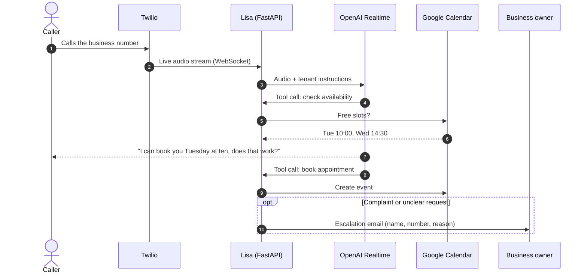

# Lisa — AI Voice Receptionist

**An AI receptionist that answers a small business's phone, books appointments in its calendar, and alerts the owner when a human is needed.**


[](https://github.com/DomienDarmontAntwerpen/lisa_ai_assistant/actions/workflows/tests.yml)

> **In short:** small businesses (hair salons, garages, practices) miss calls all day because they are busy with customers. Lisa picks up the business's existing phone number, has a natural spoken conversation, checks the agenda, books the appointment, and emails the owner when something needs a human. One codebase serves many businesses, each with its own number, tone and calendar.



---

## What it does

- **Answers calls live** in a natural voice, with low latency.
- **Recognises the caller** by phone number: existing customers get their context, new customers go through a short intake.
- **Checks availability and books appointments** directly in the business's Google Calendar.
- **Escalates to a human** for complaints or uncertain cases by emailing the owner with the caller's name, number, time and reason.
- **Multi-tenant from day one**: every business ("tenant") has its own phone number, niche, instructions and calendar connection.
- **Internal dashboard** showing calls, cost per call, escalations and full transcripts for each tenant.
- **GDPR-minded**: transcripts are encrypted at rest and purged after a configurable retention period.

## How it works

A single model handles the whole conversation (speech, decisions and tool calls) in one real-time session. This avoids the latency of chaining a speech model to a separate "brain" model. The business logic (`app/agent.py`) does not depend on the niche or the LLM provider, so the same core serves every type of business.

## Tech stack

| Layer | Technology |
|---|---|
| Voice & reasoning | OpenAI Realtime API (`gpt-realtime`) |
| Telephony | Twilio Voice + Media Streams |
| Backend | FastAPI, WebSockets, asyncio |
| Database | PostgreSQL (`asyncpg`), Fernet-encrypted transcripts |
| Integrations | Google Calendar API, Gmail API |
| Hosting | Railway (`Procfile`) |
| Testing | pytest, pytest-asyncio |

## Getting started

### Prerequisites
- Python 3.11+
- PostgreSQL
- An OpenAI API key with Realtime access
- A Twilio phone number (only for real calls; the dev tools work without one)

### Installation
```bash
git clone https://github.com/DomienDarmontAntwerpen/lisa_ai_assistant.git
cd lisa_ai_assistant
python3 -m venv .venv
source .venv/bin/activate
pip install -r requirements.txt
```

### Configuration
```bash
cp .env.example .env
```
Fill in `DATABASE_URL`, `OPENAI_API_KEY` and `CONVERSATION_ENCRYPTION_KEY`. Every variable is documented in [.env.example](.env.example).

### Run
```bash
uvicorn app.main:app --reload
```
Point your Twilio number's voice webhook to `https://<your-host>/voice`.

To try Lisa without a phone, the dev tools in [devtools/](devtools/) let you talk to the same conversation engine by text or microphone.

## Running the tests
```bash
pytest
```
The 75 tests mock every external service (OpenAI, Twilio, Google), so they don't need API keys.

## Project structure
```
lisa_ai_assistant/
├── app/              # Production code: routes, voice stream, agent, tenants, integrations
│   └── integrations/ # Calendar adapters (Google Calendar, "none" fallback)
├── dashboard/        # Internal read-only dashboard (calls, costs, transcripts)
├── onboarding/       # One-time setup flows for new businesses
├── devtools/         # Talk to Lisa locally via text or microphone
├── tests/            # pytest suite
├── PRIVACYBELEID_TEMPLATE.md  # Privacy policy template for client businesses (Dutch)
├── pytest.ini
├── railway.cron.json # Scheduled jobs on Railway
├── requirements.txt
└── Procfile          # Railway deployment
```

## Status & next steps
Built and tested end to end, including a deployment on Railway with a real phone number. Currently not in active use. The demo phone number is no longer active: to try Lisa live, connect your own Twilio number as described in [Run](#run); the offline test suite shows the behaviour without one. Possible next steps:
- A WhatsApp channel (missed-call follow-up)
- Additional calendar adapters (Outlook, custom booking systems)

## Author
**Domien Darmont** — Operational leader building applied AI systems, Antwerp, Belgium  
GitHub: [@DomienDarmontAntwerpen](https://github.com/DomienDarmontAntwerpen)  
LinkedIn: [Domien Darmont](https://www.linkedin.com/in/domiendarmont/)

A live demo, the project presentation or answers to any questions are available on request.

## License
© 2026 Domien Darmont. All rights reserved.

The source code of this project is published for viewing and evaluation only. No permission is granted to copy, modify, distribute or use it, in whole or in part, without prior written consent from the author.
